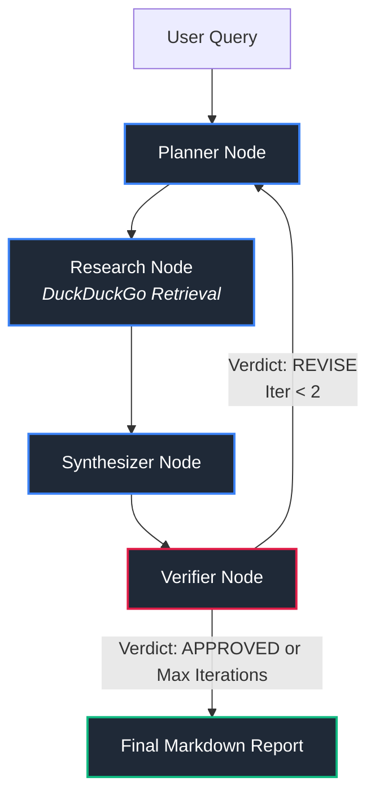

# Veritas: Autonomous Multi-Agent Verification Pipeline

An autonomous cyclical multi-agent research and factual verification pipeline built with **LangGraph**, **Gemini 3.8 Flash**, and **Pydantic v2**.

## Architecture Overview


[Final Markdown Report]


## Key Technical Characteristics
* **State Machine Graph:** Orchestrated via `langgraph.graph.StateGraph` with conditional routing edges.
* **Deterministic Structured Outputs:** Uses Pydantic v2 schemas (`VerificationVerdict`, `FactCheckResult`) for claim-by-claim verification matrices.
* **Self-Correcting Verification:** Detects ungrounded claims and triggers targeted re-queries prior to final output generation.
* **Resilient API Architecture:** Employs strict network timeouts across model calls and web search retrieval to prevent deadlocks.

## Setup & Execution

### 1. Environment Setup
```powershell
conda activate agentic_ai
pip install -r requirements.txt
